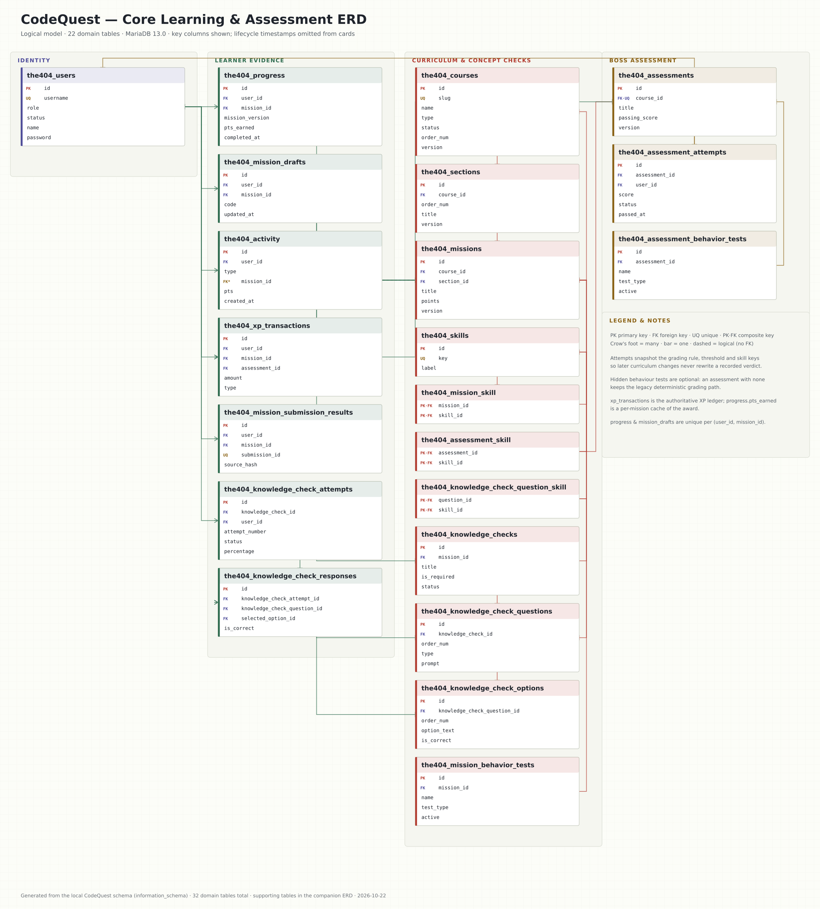
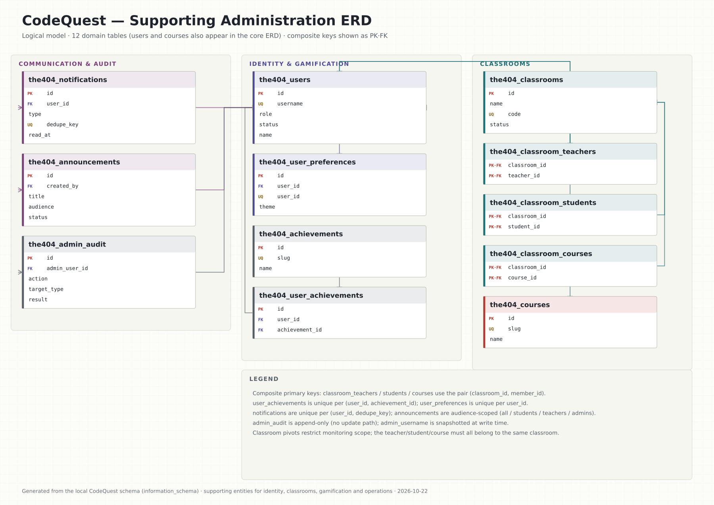

# CodeQuest — Database Design & ERD

Reference design for the CodeQuest MariaDB schema as implemented in this repository. The diagrams are logical ERDs; the tables below are the physical dictionary.

**Measured schema:** 32 domain `the404_*` tables · 250 domain columns · 45 foreign-key constraints · InnoDB · `utf8mb4_unicode_ci`. Nine Laravel framework tables also exist in the development database and are excluded from the domain model.

## 1. ERD

### Core learning & assessment ERD

Open the vector source for zooming: [`codequest-erd-core.svg`](codequest-erd-core.svg).

### Supporting administration ERD

Open the vector source: [`codequest-erd-support.svg`](codequest-erd-support.svg). `the404_users` and `the404_courses` appear in both diagrams as shared hubs; the union of the two is the 32-table domain model. An editable Mermaid overview of all 32 tables is in [`codequest-erd.mmd`](codequest-erd.mmd).

**How to read the diagrams.** `PK` = primary key; `FK` = foreign key; `UQ` = unique; `PK·FK` = a composite primary-key column that is also a foreign key. A crow's foot marks the many side; a perpendicular bar marks the one side; dashed lines are logical relationships without a physical constraint. Cards show the key attributes only; every column is in §5.

## 2. Model at a glance

| Group | Tables | Role in the system |
| --- | --- | --- |
| Identity & access | 2 | users, user_preferences |
| Curriculum & skills | 7 | courses, sections, missions, skills, mission_skill, assessment_skill, knowledge_check_question_skill |
| Learning evidence & XP | 5 | progress, mission_drafts, activity, mission_submission_results, xp_transactions |
| Knowledge Checks | 5 | knowledge_checks, knowledge_check_questions, knowledge_check_options, knowledge_check_attempts, knowledge_check_responses |
| Boss Challenge | 4 | assessments, assessment_attempts, assessment_behavior_tests, mission_behavior_tests |
| Classrooms | 4 | classrooms, classroom_teachers, classroom_students, classroom_courses |
| Gamification, communication & audit | 5 | achievements, user_achievements, notifications, announcements, admin_audit |

The academic spine is `courses → sections → missions → knowledge_checks → questions → options`. A student's evidence is written to `progress` (first completion), `mission_drafts` (in-progress source), `xp_transactions` (the authoritative XP ledger) and `activity` (the event log read by the timeline). The course-level `assessments` row is one-per-course; `assessment_attempts` keeps every attempt with a snapshot of the grading rule, threshold and skill evidence, so later curriculum edits never rewrite a recorded verdict.

## 3. Design rules and invariants

1. **Server-authoritative state.** Completion (`progress`), XP (`xp_transactions`), Knowledge Check scores (`knowledge_check_attempts`) and Boss verdicts (`assessment_attempts`) are written by server services, never by client-supplied values.
2. **One completion per student per mission.** `progress` has `UNIQUE (user_id, mission_id)`; `pts_earned` caches the first-completion award, while the ledger remains authoritative.
3. **One draft per student per mission.** `mission_drafts` has `UNIQUE (user_id, mission_id)`; a successful submission clears it.
4. **One Boss Challenge per course.** `assessments.course_id` is unique. `passing_score` is constrained by application validation to 1–100; a zero threshold is never a lenient pass.
5. **Immutable attempt evidence.** `assessment_attempts` snapshots `grading_rule`, `passing_score`, `skill_keys`, hidden-test totals and failure feedback at evaluation time. Retries append attempts; they never update earlier verdicts.
6. **Knowledge Check attempts are immutable history.** `knowledge_check_attempts` is unique per `(knowledge_check_id, user_id, attempt_number)`; `knowledge_check_responses` snapshots prompt, selected answer, correct answer and explanation as evaluated.
7. **Versioned curriculum.** Courses, sections, missions, Knowledge Checks and assessments carry a `version`; progress, drafts and attempts record the revision they were evaluated against where relevant.
8. **Append-only audit/log tables.** `xp_transactions` and `admin_audit` are append-only; `activity` is append-only and intentionally has no `updated_at`.
9. **Optional capability tables.** The two behaviour-test tables and `assessment_attempts` grading-evidence columns are optional deployment steps. The application probes them through `SchemaAvailability`; a lagging database keeps the legacy deterministic path rather than failing a write.
10. **Delete behaviour is explicit.** Children that belong to a mission or course (`sections`, `missions`, `progress`, `mission_drafts`) cascade; historical evidence and configuration (`assessment_attempts`, `xp_transactions`, pivots, audit) restrict deletion.
11. **No soft deletes.** Lifecycle is modelled with `status` enums (courses, assessments, Knowledge Checks, classrooms, announcements, users).
12. **Classroom scope is separate from access control.** Pivot tables identify which students/teachers/courses a classroom covers; authorization still re-checks the authenticated user on every request.

## 4. Entity catalogue

| Table | Purpose | Primary key | Main relationships |
| --- | --- | --- | --- |
| `the404_users` | Platform identity for every role. `username` is the login key; `role` decides the workspace; `status` is the account lifecycle gate. | `id` | — |
| `the404_user_preferences` | One row per account for appearance preferences (currently the colour theme). | `id` | user_id → users |
| `the404_courses` | Top of the curriculum: a subject (HTML, CSS, JavaScript) and its publication/order state. | `id` | — |
| `the404_sections` | Ordered chapter inside a course; missions belong to one section. | `id` | course_id → courses |
| `the404_missions` | A Coding Challenge: brief, starter/broken source, deterministic validation rule, hints and XP. | `id` | course_id → courses; section_id → sections |
| `the404_skills` | Canonical competency areas used to map curriculum and assessment evidence. | `id` | — |
| `the404_mission_skill` | Bridge mapping challenges to the skills they exercise. | `mission_id`, `skill_id` | mission_id → missions; skill_id → skills |
| `the404_assessment_skill` | Bridge mapping a Boss Challenge to the skills it evidences. | `assessment_id`, `skill_id` | assessment_id → assessments; skill_id → skills |
| `the404_knowledge_check_question_skill` | Bridge mapping a concept-check question to a skill. | `question_id`, `skill_id` | question_id → knowledge_check_questions; skill_id → skills |
| `the404_progress` | First-completion evidence for a mission, plus the XP credited on that first pass. | `id` | mission_id → missions; user_id → users |
| `the404_mission_drafts` | The single mutable in-progress source for a student and mission (explicitly saved). | `id` | mission_id → missions; user_id → users |
| `the404_activity` | Append-only learning-event log used by the timeline, feeds and analytics. | `id` | user_id → users |
| `the404_mission_submission_results` | Idempotency ledger for mission submissions keyed by submission UUID. | `id` | mission_id → missions; user_id → users |
| `the404_xp_transactions` | Authoritative XP ledger: every award, penalty, spend and refund is appended here. | `id` | assessment_id → assessments; mission_id → missions; user_id → users |
| `the404_knowledge_checks` | A published formative concept check attached to a mission. | `id` | mission_id → missions |
| `the404_knowledge_check_questions` | Ordered multiple-choice question inside a Knowledge Check. | `id` | knowledge_check_id → knowledge_checks |
| `the404_knowledge_check_options` | Answer options for a question; exactly one is correct. | `id` | knowledge_check_question_id → knowledge_check_questions |
| `the404_knowledge_check_attempts` | A student's scored attempt at a Knowledge Check, with attempt numbering. | `id` | knowledge_check_id → knowledge_checks; user_id → users |
| `the404_knowledge_check_responses` | Per-question response snapshot; keeps the prompt/answer/explanation as evaluated. | `id` | knowledge_check_attempt_id → knowledge_check_attempts; knowledge_check_question_id → knowledge_check_questions; correct_option_id → knowledge_check_options; selected_option_id → knowledge_check_options |
| `the404_assessments` | The course-level Boss Challenge: one per course, with its grading rule and pass threshold. | `id` | course_id → courses |
| `the404_assessment_attempts` | Boss Challenge attempt history with the grading evidence snapshot and verdict. | `id` | assessment_id → assessments; user_id → users |
| `the404_assessment_behavior_tests` | Optional hidden behavioural tests used by the Boss grader (when configured). | `id` | assessment_id → assessments |
| `the404_mission_behavior_tests` | Optional hidden behavioural tests for a Coding Challenge (when configured). | `id` | mission_id → missions |
| `the404_classrooms` | A teaching group that scopes which students, teachers and courses an instructor may monitor. | `id` | — |
| `the404_classroom_teachers` | Membership pivot: which instructors are assigned to a classroom. | `id` | classroom_id → classrooms; teacher_id → users |
| `the404_classroom_students` | Membership pivot: which students belong to a classroom. | `id` | classroom_id → classrooms; student_id → users |
| `the404_classroom_courses` | Scope pivot: which courses are attached to a classroom for monitoring. | `id` | classroom_id → classrooms; course_id → courses |
| `the404_achievements` | Achievement definitions and their declarative criteria. | `id` | — |
| `the404_user_achievements` | Idempotent grant of an achievement to a user. | `id` | achievement_id → achievements; user_id → users |
| `the404_notifications` | Per-user inbox row with an allow-listed destination and dedupe key. | `id` | user_id → users |
| `the404_announcements` | Administrator-authored broadcast message, audience-scoped and publishable. | `id` | created_by → users |
| `the404_admin_audit` | Append-only audit of administrative actions, with snapshotted actor name. | `id` | admin_user_id → users |

## 5. Data dictionary

### Identity & access

#### `the404_users`

Platform identity for every role. `username` is the login key; `role` decides the workspace; `status` is the account lifecycle gate.

| Column | Type | Null | Default | Key | Notes |
| --- | --- | --- | --- | --- | --- |
| `id` | `int(10) unsigned` | no | — | PK | Surrogate PK. |
| `username` | `varchar(64)` | no | — | UQ | Login key; unique, 64 chars. |
| `password` | `varchar(255)` | no | — | — | Bcrypt hash; never the plaintext. |
| `name` | `varchar(128)` | no | `''` | — | Display name. |
| `role` | `enum('student','teacher','admin','operator')` | no | `'student'` | — | Access level: student, teacher, admin or operator. |
| `status` | `enum('active','inactive')` | no | `'active'` | — | Account lifecycle: active or inactive. |
| `created_at` | `timestamp` | no | `current_timestamp()` | — | Lifecycle timestamp. |
| `updated_at` | `timestamp` | no | `current_timestamp()` | — | Lifecycle timestamp. |

**Keys & indexes:** PRIMARY KEY (`id`) · INDEX (`role`) · UNIQUE (`username`)

#### `the404_user_preferences`

One row per account for appearance preferences (currently the colour theme).

| Column | Type | Null | Default | Key | Notes |
| --- | --- | --- | --- | --- | --- |
| `id` | `int(10) unsigned` | no | — | PK | Surrogate primary key. |
| `user_id` | `int(10) unsigned` | no | — | FK → `the404_users.id` UQ | Reference identifier. |
| `theme` | `varchar(8)` | no | `'light'` | — | light or dark; null means no saved choice. |
| `created_at` | `timestamp` | yes | — | — | Lifecycle timestamp. |
| `updated_at` | `timestamp` | yes | — | — | Lifecycle timestamp. |

**Keys & indexes:** PRIMARY KEY (`id`) · UNIQUE (`user_id`)

### Curriculum & skills

#### `the404_courses`

Top of the curriculum: a subject (HTML, CSS, JavaScript) and its publication/order state.

| Column | Type | Null | Default | Key | Notes |
| --- | --- | --- | --- | --- | --- |
| `id` | `int(10) unsigned` | no | — | PK | Surrogate primary key. |
| `slug` | `varchar(64)` | no | — | UQ | Stable URL key; unique. |
| `name` | `varchar(128)` | no | — | — |  |
| `type` | `varchar(16)` | no | `'html'` | — | Technology family: html, css, js/javascript. |
| `description` | `text` | yes | — | — |  |
| `status` | `enum('active','locked','draft')` | no | `'active'` | — | active, locked or draft; an access gate, not curriculum content. |
| `order_num` | `int(10) unsigned` | no | `0` | — | Learning-path order; lower renders first. |
| `version` | `int(10) unsigned` | no | `1` | — | Curriculum revision; bumped by versioned writes. |
| `created_at` | `timestamp` | no | `current_timestamp()` | — | Lifecycle timestamp. |
| `updated_at` | `timestamp` | no | `current_timestamp()` | — | Lifecycle timestamp. |

**Keys & indexes:** PRIMARY KEY (`id`) · UNIQUE (`slug`) · INDEX (`status`)

#### `the404_sections`

Ordered chapter inside a course; missions belong to one section.

| Column | Type | Null | Default | Key | Notes |
| --- | --- | --- | --- | --- | --- |
| `id` | `int(10) unsigned` | no | — | PK | Surrogate primary key. |
| `course_id` | `int(10) unsigned` | no | — | FK → `the404_courses.id` | Reference identifier. |
| `order_num` | `int(10) unsigned` | no | `1` | — |  |
| `title` | `varchar(128)` | no | — | — | Chapter title shown in the learning path. |
| `description` | `text` | yes | — | — |  |
| `version` | `int(10) unsigned` | no | `1` | — | Curriculum revision. |
| `created_at` | `timestamp` | no | `current_timestamp()` | — | Lifecycle timestamp. |
| `updated_at` | `timestamp` | no | `current_timestamp()` | — | Lifecycle timestamp. |

**Keys & indexes:** PRIMARY KEY (`id`) · INDEX (`course_id`, `order_num`)

#### `the404_missions`

A Coding Challenge: brief, starter/broken source, deterministic validation rule, hints and XP.

| Column | Type | Null | Default | Key | Notes |
| --- | --- | --- | --- | --- | --- |
| `id` | `int(10) unsigned` | no | — | PK | Surrogate primary key. |
| `course_id` | `int(10) unsigned` | no | — | FK → `the404_courses.id` | Reference identifier. |
| `section_id` | `int(10) unsigned` | yes | — | FK → `the404_sections.id` | Reference identifier. |
| `order_num` | `int(10) unsigned` | no | `1` | — |  |
| `title` | `varchar(128)` | no | `''` | — | Challenge title; also the lesson title. |
| `difficulty` | `enum('EASY','MEDIUM','HARD')` | no | `'EASY'` | — | EASY, MEDIUM or HARD label. |
| `description` | `text` | yes | — | — | Lesson prose and the final "Your task:" paragraph. |
| `broken_code` | `mediumtext` | yes | — | — | Starter/corrupted source loaded into the editor. |
| `solution_code` | `mediumtext` | yes | — | — | Protected reference solution; never exposed until revealed. |
| `target_html` | `mediumtext` | yes | — | — | Expected structural target rendered as the reference output. |
| `validate_rule` | `mediumtext` | yes | — | — | Protected deterministic rule (JSON) evaluated server-side. |
| `hints` | `mediumtext` | yes | — | — | Ordered hint definitions (JSON); reveal costs XP. |
| `points` | `int(10) unsigned` | no | `50` | — | XP awarded once on first completion. |
| `version` | `int(10) unsigned` | no | `1` | — | Curriculum revision. |
| `created_at` | `timestamp` | no | `current_timestamp()` | — | Lifecycle timestamp. |
| `updated_at` | `timestamp` | no | `current_timestamp()` | — | Lifecycle timestamp. |

**Keys & indexes:** PRIMARY KEY (`id`) · INDEX (`course_id`) · INDEX (`course_id`, `order_num`) · INDEX (`section_id`)

#### `the404_skills`

Canonical competency areas used to map curriculum and assessment evidence.

| Column | Type | Null | Default | Key | Notes |
| --- | --- | --- | --- | --- | --- |
| `id` | `int(10) unsigned` | no | — | PK | Surrogate primary key. |
| `key` | `varchar(64)` | no | — | UQ | Stable skill key (e.g. html-structure); unique. |
| `label` | `varchar(128)` | no | — | — | Human-readable skill name. |
| `description` | `text` | yes | — | — |  |
| `created_at` | `timestamp` | no | `current_timestamp()` | — | Lifecycle timestamp. |
| `updated_at` | `timestamp` | no | `current_timestamp()` | — | Lifecycle timestamp. |

**Keys & indexes:** PRIMARY KEY (`id`) · UNIQUE (`key`)

#### `the404_mission_skill`

Bridge mapping challenges to the skills they exercise.

| Column | Type | Null | Default | Key | Notes |
| --- | --- | --- | --- | --- | --- |
| `mission_id` | `int(10) unsigned` | no | — | FK → `the404_missions.id` PK (composite) | Reference identifier. |
| `skill_id` | `int(10) unsigned` | no | — | FK → `the404_skills.id` PK (composite) | Reference identifier. |

**Keys & indexes:** INDEX (`skill_id`) · PRIMARY KEY (`mission_id`, `skill_id`)

#### `the404_assessment_skill`

Bridge mapping a Boss Challenge to the skills it evidences.

| Column | Type | Null | Default | Key | Notes |
| --- | --- | --- | --- | --- | --- |
| `assessment_id` | `int(10) unsigned` | no | — | FK → `the404_assessments.id` PK (composite) | Reference identifier. |
| `skill_id` | `int(10) unsigned` | no | — | FK → `the404_skills.id` PK (composite) | Reference identifier. |

**Keys & indexes:** INDEX (`skill_id`) · PRIMARY KEY (`assessment_id`, `skill_id`)

#### `the404_knowledge_check_question_skill`

Bridge mapping a concept-check question to a skill.

| Column | Type | Null | Default | Key | Notes |
| --- | --- | --- | --- | --- | --- |
| `question_id` | `int(10) unsigned` | no | — | FK → `the404_knowledge_check_questions.id` PK (composite) | Reference identifier. |
| `skill_id` | `int(10) unsigned` | no | — | FK → `the404_skills.id` PK (composite) | Reference identifier. |

**Keys & indexes:** INDEX (`skill_id`) · PRIMARY KEY (`question_id`, `skill_id`)

### Learning evidence & XP

#### `the404_progress`

First-completion evidence for a mission, plus the XP credited on that first pass.

| Column | Type | Null | Default | Key | Notes |
| --- | --- | --- | --- | --- | --- |
| `id` | `int(10) unsigned` | no | — | PK | Surrogate primary key. |
| `user_id` | `int(10) unsigned` | no | — | FK → `the404_users.id` | Reference identifier. |
| `mission_id` | `int(10) unsigned` | no | — | FK → `the404_missions.id` | Reference identifier. |
| `mission_version` | `int(10) unsigned` | no | `1` | — | Curriculum revision completed. |
| `skill_keys` | `text` | yes | — | — |  |
| `pts_earned` | `int(10) unsigned` | no | `0` | — | XP credited for this first completion. |
| `completed_at` | `timestamp` | no | `current_timestamp()` | — | Authoritative first-completion timestamp. |
| `created_at` | `timestamp` | no | `current_timestamp()` | — | Lifecycle timestamp. |

**Keys & indexes:** PRIMARY KEY (`id`) · INDEX (`mission_id`) · INDEX (`user_id`) · UNIQUE (`user_id`, `mission_id`)

#### `the404_mission_drafts`

The single mutable in-progress source for a student and mission (explicitly saved).

| Column | Type | Null | Default | Key | Notes |
| --- | --- | --- | --- | --- | --- |
| `id` | `int(10) unsigned` | no | — | PK | Surrogate primary key. |
| `user_id` | `int(10) unsigned` | no | — | FK → `the404_users.id` | Reference identifier. |
| `mission_id` | `int(10) unsigned` | no | — | FK → `the404_missions.id` | Reference identifier. |
| `code` | `mediumtext` | no | — | — | In-progress source; one draft per user and mission. |
| `created_at` | `timestamp` | no | `current_timestamp()` | — | Lifecycle timestamp. |
| `updated_at` | `timestamp` | no | `current_timestamp()` | — | Lifecycle timestamp. |

**Keys & indexes:** PRIMARY KEY (`id`) · INDEX (`mission_id`) · UNIQUE (`user_id`, `mission_id`)

#### `the404_activity`

Append-only learning-event log used by the timeline, feeds and analytics.

| Column | Type | Null | Default | Key | Notes |
| --- | --- | --- | --- | --- | --- |
| `id` | `int(10) unsigned` | no | — | PK | Surrogate primary key. |
| `user_id` | `int(10) unsigned` | no | — | FK → `the404_users.id` | Reference identifier. |
| `type` | `varchar(40)` | no | — | — | Event vocabulary (mission_completed, wrong_submission, knowledge_check_completed, ...). |
| `mission_id` | `int(10) unsigned` | yes | — | — | Optional mission reference for challenge analytics (logical FK; no constraint). |
| `message` | `text` | no | — | — |  |
| `pts` | `int(10) unsigned` | yes | `0` | — | XP display value for the beat, if any. |
| `created_at` | `timestamp` | no | `current_timestamp()` | — | Event time. This table intentionally has no updated_at. |

**Keys & indexes:** PRIMARY KEY (`id`) · INDEX (`mission_id`, `type`) · INDEX (`type`) · INDEX (`user_id`, `created_at`)

#### `the404_mission_submission_results`

Idempotency ledger for mission submissions keyed by submission UUID.

| Column | Type | Null | Default | Key | Notes |
| --- | --- | --- | --- | --- | --- |
| `id` | `int(10) unsigned` | no | — | PK | Surrogate primary key. |
| `user_id` | `int(10) unsigned` | no | — | FK → `the404_users.id` | Reference identifier. |
| `mission_id` | `int(10) unsigned` | no | — | FK → `the404_missions.id` | Reference identifier. |
| `mission_version` | `int(10) unsigned` | no | — | — |  |
| `submission_id` | `varchar(64)` | no | — | — | Client submission UUID; unique per user for idempotency. |
| `source_hash` | `char(64)` | no | — | — | Hash of the submitted source. |
| `failures` | `text` | no | — | — | JSON list of failed validation rules. |
| `created_at` | `timestamp` | no | `current_timestamp()` | — | Lifecycle timestamp. |

**Keys & indexes:** INDEX (`mission_id`) · UNIQUE (`user_id`, `submission_id`) · PRIMARY KEY (`id`)

#### `the404_xp_transactions`

Authoritative XP ledger: every award, penalty, spend and refund is appended here.

| Column | Type | Null | Default | Key | Notes |
| --- | --- | --- | --- | --- | --- |
| `id` | `int(10) unsigned` | no | — | PK | Surrogate primary key. |
| `user_id` | `int(10) unsigned` | no | — | FK → `the404_users.id` | Reference identifier. |
| `mission_id` | `int(10) unsigned` | yes | — | FK → `the404_missions.id` | Mission source when the ledger row relates to a challenge. |
| `mission_version` | `int(10) unsigned` | yes | — | — | Curriculum revision evidence where applicable. |
| `assessment_id` | `int(10) unsigned` | yes | — | FK → `the404_assessments.id` | Assessment source when the ledger row relates to a Boss Challenge. |
| `assessment_version` | `int(10) unsigned` | yes | — | — | Assessment revision evidence where applicable. |
| `amount` | `int(11)` | no | — | — | Signed XP delta; negative for spends and penalties. |
| `type` | `varchar(40)` | no | — | — | Ledger vocabulary (mission_completed, hint_used, solution_revealed, ...). |
| `description` | `text` | yes | — | — | Human-readable audit reason. |
| `created_at` | `timestamp` | no | `current_timestamp()` | — | Lifecycle timestamp. |

**Keys & indexes:** PRIMARY KEY (`id`) · INDEX (`assessment_id`) · INDEX (`mission_id`) · INDEX (`type`) · INDEX (`user_id`, `created_at`) · INDEX (`user_id`)

### Knowledge Checks

#### `the404_knowledge_checks`

A published formative concept check attached to a mission.

| Column | Type | Null | Default | Key | Notes |
| --- | --- | --- | --- | --- | --- |
| `id` | `int(10) unsigned` | no | — | PK | Surrogate primary key. |
| `mission_id` | `int(10) unsigned` | no | — | FK → `the404_missions.id` | Reference identifier. |
| `order_num` | `int(10) unsigned` | no | `1` | — |  |
| `title` | `varchar(128)` | no | — | — |  |
| `instructions` | `text` | yes | — | — |  |
| `is_required` | `tinyint(1)` | no | `0` | — | Whether a submitted attempt gates the mission challenge. |
| `status` | `enum('draft','published','archived')` | no | `'draft'` | — | draft, published or archived. |
| `version` | `int(10) unsigned` | no | `1` | — | Definition revision. |
| `created_at` | `timestamp` | no | `current_timestamp()` | — | Lifecycle timestamp. |
| `updated_at` | `timestamp` | no | `current_timestamp()` | — | Lifecycle timestamp. |

**Keys & indexes:** PRIMARY KEY (`id`) · UNIQUE (`mission_id`, `order_num`) · INDEX (`mission_id`, `status`, `order_num`)

#### `the404_knowledge_check_questions`

Ordered multiple-choice question inside a Knowledge Check.

| Column | Type | Null | Default | Key | Notes |
| --- | --- | --- | --- | --- | --- |
| `id` | `int(10) unsigned` | no | — | PK | Surrogate primary key. |
| `knowledge_check_id` | `int(10) unsigned` | no | — | FK → `the404_knowledge_checks.id` | Reference identifier. |
| `order_num` | `int(10) unsigned` | no | `1` | — |  |
| `type` | `enum('multiple_choice','code_reading','concept_identification')` | no | — | — | multiple_choice, code_reading or concept_identification. |
| `prompt` | `text` | no | — | — | Question text. |
| `code_snippet` | `mediumtext` | yes | — | — |  |
| `explanation` | `text` | yes | — | — |  |
| `created_at` | `timestamp` | no | `current_timestamp()` | — | Lifecycle timestamp. |
| `updated_at` | `timestamp` | no | `current_timestamp()` | — | Lifecycle timestamp. |

**Keys & indexes:** UNIQUE (`knowledge_check_id`, `order_num`) · PRIMARY KEY (`id`)

#### `the404_knowledge_check_options`

Answer options for a question; exactly one is correct.

| Column | Type | Null | Default | Key | Notes |
| --- | --- | --- | --- | --- | --- |
| `id` | `int(10) unsigned` | no | — | PK | Surrogate primary key. |
| `knowledge_check_question_id` | `int(10) unsigned` | no | — | FK → `the404_knowledge_check_questions.id` | Reference identifier. |
| `order_num` | `int(10) unsigned` | no | `1` | — |  |
| `option_text` | `text` | no | — | — |  |
| `is_correct` | `tinyint(1)` | no | `0` | — | Trusted answer marker; one correct option per question. |
| `created_at` | `timestamp` | no | `current_timestamp()` | — | Lifecycle timestamp. |
| `updated_at` | `timestamp` | no | `current_timestamp()` | — | Lifecycle timestamp. |

**Keys & indexes:** INDEX (`knowledge_check_question_id`, `is_correct`) · UNIQUE (`knowledge_check_question_id`, `order_num`) · PRIMARY KEY (`id`)

#### `the404_knowledge_check_attempts`

A student's scored attempt at a Knowledge Check, with attempt numbering.

| Column | Type | Null | Default | Key | Notes |
| --- | --- | --- | --- | --- | --- |
| `id` | `int(10) unsigned` | no | — | PK | Surrogate primary key. |
| `knowledge_check_id` | `int(10) unsigned` | no | — | FK → `the404_knowledge_checks.id` | Reference identifier. |
| `knowledge_check_version` | `int(10) unsigned` | no | `1` | — |  |
| `user_id` | `int(10) unsigned` | no | — | FK → `the404_users.id` | Reference identifier. |
| `attempt_number` | `int(10) unsigned` | no | — | — | Monotonic attempt number per user and check. |
| `status` | `enum('started','submitted')` | no | `'started'` | — | started or submitted. |
| `score` | `int(10) unsigned` | yes | — | — |  |
| `total_questions` | `int(10) unsigned` | yes | — | — |  |
| `percentage` | `int(10) unsigned` | yes | — | — | Correct answers / total questions at submission. |
| `started_at` | `timestamp` | no | `current_timestamp()` | — | Timestamp. |
| `submitted_at` | `timestamp` | yes | — | — | Timestamp. |
| `created_at` | `timestamp` | no | `current_timestamp()` | — | Lifecycle timestamp. |
| `updated_at` | `timestamp` | no | `current_timestamp()` | — | Lifecycle timestamp. |

**Keys & indexes:** UNIQUE (`knowledge_check_id`, `user_id`, `attempt_number`) · PRIMARY KEY (`id`) · INDEX (`knowledge_check_id`, `status`) · INDEX (`user_id`, `submitted_at`)

#### `the404_knowledge_check_responses`

Per-question response snapshot; keeps the prompt/answer/explanation as evaluated.

| Column | Type | Null | Default | Key | Notes |
| --- | --- | --- | --- | --- | --- |
| `id` | `int(10) unsigned` | no | — | PK | Surrogate primary key. |
| `knowledge_check_attempt_id` | `int(10) unsigned` | no | — | FK → `the404_knowledge_check_attempts.id` | Reference identifier. |
| `knowledge_check_question_id` | `int(10) unsigned` | no | — | FK → `the404_knowledge_check_questions.id` | Reference identifier. |
| `selected_option_id` | `int(10) unsigned` | no | — | FK → `the404_knowledge_check_options.id` | Reference identifier. |
| `correct_option_id` | `int(10) unsigned` | no | — | FK → `the404_knowledge_check_options.id` | Reference identifier. |
| `is_correct` | `tinyint(1)` | no | — | — | Computed correctness for this response. |
| `prompt_snapshot` | `text` | no | — | — | Prompt exactly as evaluated. |
| `selected_option_snapshot` | `text` | no | — | — | Selected answer text at evaluation time. |
| `correct_option_snapshot` | `text` | no | — | — | Correct answer text at evaluation time. |
| `explanation_snapshot` | `text` | yes | — | — | Explanation shown at evaluation time. |
| `skill_keys` | `text` | yes | — | — |  |
| `created_at` | `timestamp` | no | `current_timestamp()` | — | Lifecycle timestamp. |

**Keys & indexes:** UNIQUE (`knowledge_check_attempt_id`, `knowledge_check_question_id`) · INDEX (`knowledge_check_question_id`, `is_correct`) · PRIMARY KEY (`id`) · INDEX (`correct_option_id`) · INDEX (`selected_option_id`)

### Boss Challenge

#### `the404_assessments`

The course-level Boss Challenge: one per course, with its grading rule and pass threshold.

| Column | Type | Null | Default | Key | Notes |
| --- | --- | --- | --- | --- | --- |
| `id` | `int(10) unsigned` | no | — | PK | Surrogate primary key. |
| `course_id` | `int(10) unsigned` | no | — | FK → `the404_courses.id` UQ | One Boss Challenge per course; unique. |
| `title` | `varchar(128)` | no | — | — |  |
| `description` | `text` | yes | — | — |  |
| `instructions` | `text` | yes | — | — |  |
| `grading_rule` | `mediumtext` | yes | — | — | Protected pattern-rule definition (JSON). |
| `passing_score` | `int(10) unsigned` | no | `70` | — | Minimum percentage to pass; validated 1–100. |
| `version` | `int(10) unsigned` | no | `1` | — | Assessment revision; version-bumped on rule change. |
| `status` | `enum('active','locked','draft')` | no | `'active'` | — | active, locked or draft. |
| `created_at` | `timestamp` | no | `current_timestamp()` | — | Lifecycle timestamp. |
| `updated_at` | `timestamp` | no | `current_timestamp()` | — | Lifecycle timestamp. |

**Keys & indexes:** PRIMARY KEY (`id`) · UNIQUE (`course_id`) · INDEX (`status`)

#### `the404_assessment_attempts`

Boss Challenge attempt history with the grading evidence snapshot and verdict.

| Column | Type | Null | Default | Key | Notes |
| --- | --- | --- | --- | --- | --- |
| `id` | `int(10) unsigned` | no | — | PK | Surrogate primary key. |
| `assessment_id` | `int(10) unsigned` | no | — | FK → `the404_assessments.id` | Reference identifier. |
| `assessment_version` | `int(10) unsigned` | no | `1` | — |  |
| `user_id` | `int(10) unsigned` | no | — | FK → `the404_users.id` | Reference identifier. |
| `code` | `mediumtext` | yes | — | — |  |
| `grading_rule_snapshot` | `mediumtext` | yes | — | — | Grading rule as evaluated; later edits do not rewrite it. |
| `passing_score_snapshot` | `int(10) unsigned` | yes | — | — | Threshold as evaluated. |
| `skill_keys` | `text` | yes | — | — | Skill evidence snapshot for competency. |
| `score` | `int(10) unsigned` | yes | — | — | Combined percentage recorded at evaluation. |
| `tests_total` | `int(10) unsigned` | yes | — | — | Hidden behavioural checks evaluated. |
| `tests_passed` | `int(10) unsigned` | yes | — | — | Hidden behavioural checks passed. |
| `failure_feedback` | `text` | yes | — | — | Student-facing failure explanation. |
| `status` | `enum('available','started','submitted','evaluated','passed','failed')` | no | `'available'` | — | available, started, submitted, evaluated, passed or failed. |
| `passed_at` | `timestamp` | yes | — | — | First successful pass timestamp. |
| `submitted_at` | `timestamp` | yes | — | — | Timestamp. |
| `created_at` | `timestamp` | no | `current_timestamp()` | — | Lifecycle timestamp. |
| `updated_at` | `timestamp` | no | `current_timestamp()` | — | Lifecycle timestamp. |

**Keys & indexes:** PRIMARY KEY (`id`) · INDEX (`assessment_id`) · INDEX (`assessment_id`, `user_id`) · INDEX (`user_id`)

#### `the404_assessment_behavior_tests`

Optional hidden behavioural tests used by the Boss grader (when configured).

| Column | Type | Null | Default | Key | Notes |
| --- | --- | --- | --- | --- | --- |
| `id` | `int(10) unsigned` | no | — | PK | Surrogate primary key. |
| `assessment_id` | `int(10) unsigned` | no | — | FK → `the404_assessments.id` | Reference identifier. |
| `name` | `varchar(120)` | no | — | — |  |
| `test_type` | `enum('function','console')` | no | — | — | Grader test family. |
| `configuration` | `text` | no | — | — | Test definition consumed by the grader. |
| `order_num` | `int(10) unsigned` | no | `1` | — |  |
| `active` | `tinyint(1)` | no | `1` | — | Only active tests are graded. |
| `created_at` | `timestamp` | no | `current_timestamp()` | — | Lifecycle timestamp. |
| `updated_at` | `timestamp` | no | `current_timestamp()` | — | Lifecycle timestamp. |

**Keys & indexes:** PRIMARY KEY (`id`) · UNIQUE (`assessment_id`, `order_num`)

#### `the404_mission_behavior_tests`

Optional hidden behavioural tests for a Coding Challenge (when configured).

| Column | Type | Null | Default | Key | Notes |
| --- | --- | --- | --- | --- | --- |
| `id` | `int(10) unsigned` | no | — | PK | Surrogate primary key. |
| `mission_id` | `int(10) unsigned` | no | — | FK → `the404_missions.id` | Reference identifier. |
| `name` | `varchar(120)` | no | — | — |  |
| `test_type` | `enum('function','console')` | no | — | — |  |
| `configuration` | `text` | no | — | — | Test definition consumed by the grader. |
| `order_num` | `int(10) unsigned` | no | `1` | — |  |
| `active` | `tinyint(1)` | no | `1` | — |  |
| `created_at` | `timestamp` | no | `current_timestamp()` | — | Lifecycle timestamp. |
| `updated_at` | `timestamp` | no | `current_timestamp()` | — | Lifecycle timestamp. |

**Keys & indexes:** PRIMARY KEY (`id`) · UNIQUE (`mission_id`, `order_num`)

### Classrooms

#### `the404_classrooms`

A teaching group that scopes which students, teachers and courses an instructor may monitor.

| Column | Type | Null | Default | Key | Notes |
| --- | --- | --- | --- | --- | --- |
| `id` | `int(10) unsigned` | no | — | PK | Surrogate primary key. |
| `name` | `varchar(128)` | no | — | — |  |
| `code` | `varchar(32)` | yes | — | UQ | Human-friendly classroom code; unique when present. |
| `status` | `enum('active','inactive')` | no | `'active'` | — | active or inactive. |
| `created_at` | `timestamp` | yes | — | — | Lifecycle timestamp. |
| `updated_at` | `timestamp` | yes | — | — | Lifecycle timestamp. |

**Keys & indexes:** PRIMARY KEY (`id`) · UNIQUE (`code`) · INDEX (`status`)

#### `the404_classroom_teachers`

Membership pivot: which instructors are assigned to a classroom.

| Column | Type | Null | Default | Key | Notes |
| --- | --- | --- | --- | --- | --- |
| `classroom_id` | `int(10) unsigned` | no | — | FK → `the404_classrooms.id` | Reference identifier. |
| `teacher_id` | `int(10) unsigned` | no | — | FK → `the404_users.id` | Reference identifier. |
| `created_at` | `timestamp` | yes | — | — | Lifecycle timestamp. |
| `updated_at` | `timestamp` | yes | — | — | Lifecycle timestamp. |

**Keys & indexes:** UNIQUE (`classroom_id`, `teacher_id`) · INDEX (`teacher_id`, `classroom_id`)

#### `the404_classroom_students`

Membership pivot: which students belong to a classroom.

| Column | Type | Null | Default | Key | Notes |
| --- | --- | --- | --- | --- | --- |
| `classroom_id` | `int(10) unsigned` | no | — | FK → `the404_classrooms.id` | Reference identifier. |
| `student_id` | `int(10) unsigned` | no | — | FK → `the404_users.id` | Reference identifier. |
| `created_at` | `timestamp` | yes | — | — | Lifecycle timestamp. |
| `updated_at` | `timestamp` | yes | — | — | Lifecycle timestamp. |

**Keys & indexes:** UNIQUE (`classroom_id`, `student_id`) · INDEX (`student_id`, `classroom_id`)

#### `the404_classroom_courses`

Scope pivot: which courses are attached to a classroom for monitoring.

| Column | Type | Null | Default | Key | Notes |
| --- | --- | --- | --- | --- | --- |
| `classroom_id` | `int(10) unsigned` | no | — | FK → `the404_classrooms.id` | Reference identifier. |
| `course_id` | `int(10) unsigned` | no | — | FK → `the404_courses.id` | Reference identifier. |
| `created_at` | `timestamp` | yes | — | — | Lifecycle timestamp. |
| `updated_at` | `timestamp` | yes | — | — | Lifecycle timestamp. |

**Keys & indexes:** UNIQUE (`classroom_id`, `course_id`) · INDEX (`course_id`, `classroom_id`)

### Gamification, communication & audit

#### `the404_achievements`

Achievement definitions and their declarative criteria.

| Column | Type | Null | Default | Key | Notes |
| --- | --- | --- | --- | --- | --- |
| `id` | `int(10) unsigned` | no | — | PK | Surrogate primary key. |
| `slug` | `varchar(40)` | no | — | UQ | Stable achievement key; unique. |
| `name` | `varchar(80)` | no | — | — | Display name. |
| `description` | `text` | yes | — | — | Criteria shown to the student. |
| `created_at` | `timestamp` | yes | — | — | Lifecycle timestamp. |
| `updated_at` | `timestamp` | yes | — | — | Lifecycle timestamp. |

**Keys & indexes:** PRIMARY KEY (`id`) · UNIQUE (`slug`)

#### `the404_user_achievements`

Idempotent grant of an achievement to a user.

| Column | Type | Null | Default | Key | Notes |
| --- | --- | --- | --- | --- | --- |
| `id` | `int(10) unsigned` | no | — | PK | Surrogate primary key. |
| `user_id` | `int(10) unsigned` | no | — | FK → `the404_users.id` | Reference identifier. |
| `achievement_id` | `int(10) unsigned` | no | — | FK → `the404_achievements.id` | Reference identifier. |
| `created_at` | `timestamp` | no | `current_timestamp()` | — | Lifecycle timestamp. |

**Keys & indexes:** PRIMARY KEY (`id`) · INDEX (`achievement_id`) · UNIQUE (`user_id`, `achievement_id`)

#### `the404_notifications`

Per-user inbox row with an allow-listed destination and dedupe key.

| Column | Type | Null | Default | Key | Notes |
| --- | --- | --- | --- | --- | --- |
| `id` | `int(10) unsigned` | no | — | PK | Surrogate primary key. |
| `user_id` | `int(10) unsigned` | no | — | FK → `the404_users.id` | Reference identifier. |
| `type` | `varchar(40)` | no | — | — | Notification vocabulary; drives the safe destination allow-list. |
| `title` | `varchar(160)` | no | — | — |  |
| `message` | `text` | no | — | — |  |
| `data` | `text` | yes | — | — |  |
| `dedupe_key` | `varchar(100)` | yes | — | — | Idempotency key unique per user; prevents duplicate notices. |
| `read_at` | `timestamp` | yes | — | — | Null means unread. |
| `created_at` | `timestamp` | no | `current_timestamp()` | — | Lifecycle timestamp. |

**Keys & indexes:** PRIMARY KEY (`id`) · INDEX (`user_id`, `created_at`) · UNIQUE (`user_id`, `dedupe_key`) · INDEX (`user_id`, `read_at`)

#### `the404_announcements`

Administrator-authored broadcast message, audience-scoped and publishable.

| Column | Type | Null | Default | Key | Notes |
| --- | --- | --- | --- | --- | --- |
| `id` | `int(10) unsigned` | no | — | PK | Surrogate primary key. |
| `created_by` | `int(10) unsigned` | no | — | FK → `the404_users.id` |  |
| `title` | `varchar(160)` | no | — | — |  |
| `message` | `text` | no | — | — |  |
| `audience` | `enum('all','students','teachers','admins')` | no | `'all'` | — | all, students, teachers or admins. |
| `status` | `enum('draft','published','archived')` | no | `'draft'` | — | draft, published or archived. |
| `published_at` | `timestamp` | yes | — | — | Publication timestamp; null while draft. |
| `created_at` | `timestamp` | no | `current_timestamp()` | — | Lifecycle timestamp. |
| `updated_at` | `timestamp` | no | `current_timestamp()` | — | Lifecycle timestamp. |

**Keys & indexes:** PRIMARY KEY (`id`) · INDEX (`audience`) · INDEX (`created_at`) · INDEX (`created_by`) · INDEX (`status`)

#### `the404_admin_audit`

Append-only audit of administrative actions, with snapshotted actor name.

| Column | Type | Null | Default | Key | Notes |
| --- | --- | --- | --- | --- | --- |
| `id` | `int(10) unsigned` | no | — | PK | Surrogate primary key. |
| `admin_user_id` | `int(10) unsigned` | no | — | FK → `the404_users.id` | Reference identifier. |
| `admin_username` | `varchar(64)` | no | — | — | Actor name snapshotted at write time. |
| `action` | `varchar(64)` | no | — | — | Audited action key. |
| `target_type` | `varchar(40)` | yes | — | — | Target entity family. |
| `target_id` | `int(10) unsigned` | yes | — | — | Target identifier when applicable. |
| `summary` | `text` | no | — | — | Human-readable change summary. |
| `result` | `enum('success','failed')` | no | `'success'` | — | success or failed. |
| `created_at` | `timestamp` | no | `current_timestamp()` | — | Lifecycle timestamp. |

**Keys & indexes:** PRIMARY KEY (`id`) · INDEX (`action`) · INDEX (`admin_user_id`) · INDEX (`created_at`) · INDEX (`target_type`, `target_id`)

## 6. Relationship catalogue

All physical foreign keys, with the child table owning the constraint. Cardinality is one parent to many children; nullable child columns mean zero-to-many. The bridge tables (`mission_skill`, `assessment_skill`, `knowledge_check_question_skill`, `classroom_*`) implement many-to-many relationships: each side is a one-to-many FK and the pair is the primary key.

| Child table | Column | Parent | Delete rule | Cardinality |
| --- | --- | --- | --- | --- |
| `the404_activity` | `user_id` | `the404_users` | CASCADE | 1..N |
| `the404_admin_audit` | `admin_user_id` | `the404_users` | RESTRICT | 1..N |
| `the404_announcements` | `created_by` | `the404_users` | RESTRICT | 1..N |
| `the404_assessments` | `course_id` | `the404_courses` | RESTRICT | 1..N |
| `the404_assessment_attempts` | `assessment_id` | `the404_assessments` | RESTRICT | 1..N |
| `the404_assessment_attempts` | `user_id` | `the404_users` | RESTRICT | 1..N |
| `the404_assessment_behavior_tests` | `assessment_id` | `the404_assessments` | RESTRICT | 1..N |
| `the404_assessment_skill` | `assessment_id` | `the404_assessments` | RESTRICT | 1..N |
| `the404_assessment_skill` | `skill_id` | `the404_skills` | RESTRICT | 1..N |
| `the404_classroom_courses` | `classroom_id` | `the404_classrooms` | RESTRICT | 1..N |
| `the404_classroom_courses` | `course_id` | `the404_courses` | RESTRICT | 1..N |
| `the404_classroom_students` | `classroom_id` | `the404_classrooms` | RESTRICT | 1..N |
| `the404_classroom_students` | `student_id` | `the404_users` | RESTRICT | 1..N |
| `the404_classroom_teachers` | `classroom_id` | `the404_classrooms` | RESTRICT | 1..N |
| `the404_classroom_teachers` | `teacher_id` | `the404_users` | RESTRICT | 1..N |
| `the404_knowledge_checks` | `mission_id` | `the404_missions` | RESTRICT | 1..N |
| `the404_knowledge_check_attempts` | `knowledge_check_id` | `the404_knowledge_checks` | RESTRICT | 1..N |
| `the404_knowledge_check_attempts` | `user_id` | `the404_users` | RESTRICT | 1..N |
| `the404_knowledge_check_options` | `knowledge_check_question_id` | `the404_knowledge_check_questions` | RESTRICT | 1..N |
| `the404_knowledge_check_questions` | `knowledge_check_id` | `the404_knowledge_checks` | RESTRICT | 1..N |
| `the404_knowledge_check_question_skill` | `question_id` | `the404_knowledge_check_questions` | RESTRICT | 1..N |
| `the404_knowledge_check_question_skill` | `skill_id` | `the404_skills` | RESTRICT | 1..N |
| `the404_knowledge_check_responses` | `knowledge_check_attempt_id` | `the404_knowledge_check_attempts` | RESTRICT | 1..N |
| `the404_knowledge_check_responses` | `knowledge_check_question_id` | `the404_knowledge_check_questions` | RESTRICT | 1..N |
| `the404_knowledge_check_responses` | `correct_option_id` | `the404_knowledge_check_options` | RESTRICT | 1..N |
| `the404_knowledge_check_responses` | `selected_option_id` | `the404_knowledge_check_options` | RESTRICT | 1..N |
| `the404_missions` | `course_id` | `the404_courses` | CASCADE | 1..N |
| `the404_missions` | `section_id` | `the404_sections` | RESTRICT | 0..N |
| `the404_mission_behavior_tests` | `mission_id` | `the404_missions` | RESTRICT | 1..N |
| `the404_mission_drafts` | `mission_id` | `the404_missions` | CASCADE | 1..N |
| `the404_mission_drafts` | `user_id` | `the404_users` | CASCADE | 1..N |
| `the404_mission_skill` | `mission_id` | `the404_missions` | RESTRICT | 1..N |
| `the404_mission_skill` | `skill_id` | `the404_skills` | RESTRICT | 1..N |
| `the404_mission_submission_results` | `mission_id` | `the404_missions` | RESTRICT | 1..N |
| `the404_mission_submission_results` | `user_id` | `the404_users` | RESTRICT | 1..N |
| `the404_notifications` | `user_id` | `the404_users` | RESTRICT | 1..N |
| `the404_progress` | `mission_id` | `the404_missions` | CASCADE | 1..N |
| `the404_progress` | `user_id` | `the404_users` | CASCADE | 1..N |
| `the404_sections` | `course_id` | `the404_courses` | CASCADE | 1..N |
| `the404_user_achievements` | `achievement_id` | `the404_achievements` | RESTRICT | 1..N |
| `the404_user_achievements` | `user_id` | `the404_users` | RESTRICT | 1..N |
| `the404_user_preferences` | `user_id` | `the404_users` | CASCADE | 1..N |
| `the404_xp_transactions` | `assessment_id` | `the404_assessments` | RESTRICT | 0..N |
| `the404_xp_transactions` | `mission_id` | `the404_missions` | RESTRICT | 0..N |
| `the404_xp_transactions` | `user_id` | `the404_users` | RESTRICT | 1..N |

**Logical relationship without a physical constraint:** `the404_activity.mission_id → the404_missions.id` (nullable; used for challenge analytics and intentionally not constrained, so event rows survive mission deletion).

## 7. Framework tables (excluded from the domain ERD)

The development database also contains the Laravel support tables: `cache`, `cache_locks`, `failed_jobs`, `job_batches`, `jobs`, `migrations`, `password_reset_tokens`, `sessions`, `users`. They serve sessions, cache, queues, migrations and password resets. The application's user identity lives in `the404_users`; the framework `users` table is not the domain user table. Production `system404` has historically contained only five domain tables (`the404_users`, `the404_courses`, `the404_missions`, `the404_progress`, `the404_activity`), so schema changes are applied in approved steps and optional tables must degrade rather than crash.

## 8. Deployment notes

- **Do not run `php artisan migrate` against production `system404`.** The `2026_09_03_the404_*` migrations mirror tables that already exist there and are used with `RefreshDatabase` on SQLite for tests. Apply production DDL explicitly with approval.
- **Optional schema.** `the404_assessment_behavior_tests`, `the404_mission_behavior_tests` and the grading-evidence columns on `the404_assessment_attempts` are optional. `App\Support\SchemaAvailability` probes them; a missing behaviour-test table keeps the legacy pattern-only Boss path, and a missing column must not turn a graded write into a 500.
- **Engine and charset.** Every domain table is InnoDB with `utf8mb4_unicode_ci`. Primary keys are unsigned auto-increment integers; bridges use composite primary keys and no surrogate id.
- **Snapshot versus normalisation.** The model is normalised through the curriculum and evidence tables; the deliberate denormalised columns are audit/evidence snapshots (`grading_rule_snapshot`, `passing_score_snapshot`, `skill_keys`, question/option/explanation snapshots) and the `pts_earned` cache. These preserve what was true when a verdict was recorded.

## 9. Differences from the submitted documentation

The supplied `CodeQuest_Documentation.docx` data dictionary is a useful summary but drifts from the running schema in these places; this document follows the database:

- `the404_xp_transactions` is documented with `source_type`, `source_id` and `reason`. The actual columns are `mission_id`, `mission_version`, `assessment_id`, `assessment_version`, `amount`, `type` and `description`.
- The Knowledge Check tables are `the404_knowledge_check_*`; the document drops the `the404_` prefix.
- The hidden behaviour-test tables (`the404_assessment_behavior_tests`, `the404_mission_behavior_tests`) and the grading-evidence columns on `the404_assessment_attempts` (`grading_rule_snapshot`, `passing_score_snapshot`, `skill_keys`, `tests_total`, `tests_passed`, `failure_feedback`) are not in the document's dictionary.
- Support tables added after the document was drafted — `the404_activity.mission_id`, `the404_mission_submission_results`, `the404_notifications`, `the404_announcements`, `the404_admin_audit`, `the404_user_preferences` — are absent from its table list.
- The document's "Entity Relationship Diagram" section has no rendered ERD; the two figures above supply the core and supporting views.

## 10. Provenance

Generated from the running local schema via `information_schema` on 2026-10-22: `TABLES`, `COLUMNS`, `KEY_COLUMN_USAGE`, `REFERENTIAL_CONSTRAINTS` and `STATISTICS`. Table names and columns are verbatim. The two ERD drawings are logical views: only key attributes are drawn; the dictionary above is authoritative for every column.
